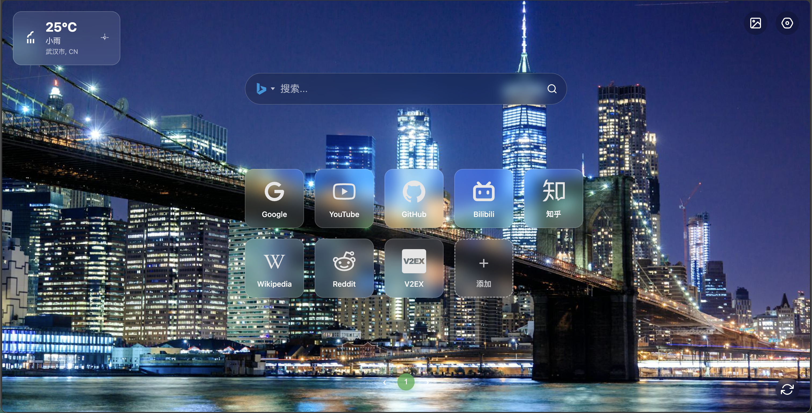

# New Tab Pro - Intelligent New Tab Manager



New Tab Pro turns your new tab into a clean and efficient workspace: modern UI, wallpaper management, multi-engine search, shortcut management, and weather.

## 🚀 Core Features

### 🌟 Wallpaper

- Bing daily (default) and Pexels search
- Preference memory and cached selected wallpaper
- Categories and paginated browsing

### 🔍 Search

- One-click switch among Baidu, Google, Bing, Sogou, DuckDuckGo
- Search history (click-to-fill, clear all, remove single)

### 🎯 Shortcuts

- 10 per page (9 items + 1 add button), unified sizing
- Drag-and-drop sort (same page), right-click edit/delete
- Single DOM update per pagination action

### 🌤️ Weather (Gaode/AMap)

- Auto location or manual city (city name converted to adcode)
- Caching & rate limiting: adcode cache, weather TTL, min request interval
- Unified request wrapper: timeout, retries (exponential backoff), error parsing
- Chinese phenomenon → built-in SVG icons

## ⚙️ Config & Permissions

- In settings panel:
    - Pexels API Key (optional)
    - Gaode (AMap) Weather Key (required for weather) and City (leave empty to auto locate)
- `manifest.json` permissions:
    - `geolocation`
    - `host_permissions`: `https://restapi.amap.com/`
- CSP: favicon icons come from target sites, `img-src * data:` allows broad compatibility.

## 🧱 Architecture & Conventions

- Modular: see `README-MODULES.md`
    - `SettingsManager` central config I/O and legacy key migration
    - `WeatherManager` uses `utils/request.js` and `config/weather-config.js`
    - Selector constants: `constants/selectors.js` via `window.SELECTORS`
    - Weather icons & visibility toggle: `components/weather-icons.js`, `components/visibility-toggle.js`
- Code quality:
    - Lint/Format: `npm run lint`, `npm run format`
    - EditorConfig for consistent whitespace/newlines

## 📦 Install & Use

### From Store (Edge)

1. Open Edge Add-ons Store
2. Search "New Tab Pro" and install
3. Open a new tab

### Load Locally

1. Clone the repository
2. Open extensions page, enable Developer Mode
3. Load unpacked and select the project folder

## 🔧 Advanced

### Wallpaper cache verification

1. Set Pexels API Key
2. Pick a wallpaper and refresh the tab
3. Observe flicker-free loading and persistence

### Shortcuts

1. Click Add to input info
2. Drag to sort (same page)
3. Right-click to edit/delete

## Development

Install tools and run lint/format:

```bash
npm install
npm run lint
npm run format
```

ESLint is configured for browser extensions and recognizes globals like `chrome` and `Sortable`.

## 🤝 Contributing

- Run `npm run lint` before PRs
- Follow modularization and selector constantization conventions

## 📄 License

- MIT

## 🔮 Roadmap

- [ ] More wallpaper sources
- [ ] Optional themes and sync
- [ ] Tests and TypeScript support

---

New Tab Pro - Redefine your new tab
