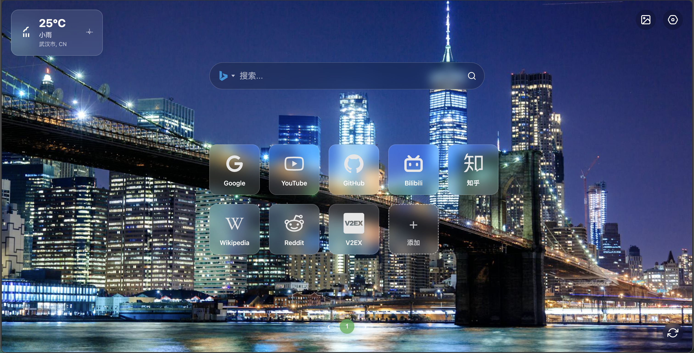

# New Tab - 一款现代化、功能丰富的浏览器新标签页



New Tab 是一款旨在通过美观的设计和强大的功能，重塑您浏览器新标签页体验的Chrome插件。它拥有iOS风格的毛玻璃质感界面、动态壁纸、以及集成了多种搜索引擎的强大搜索栏，为您带来既高效又赏心悦目的浏览体验。

## ✨ 主要功能

- **🌌 动态高清壁纸**：
    - 默认使用必应每日壁纸，每日自动更新。
    - 支持集成Pexels API，您可以轻松搜索、浏览并设置数百万张高质量的专业摄影作品作为您的背景。
    - 强大的壁纸库功能，支持按分类浏览、关键词搜索和分页查看。
    - 记住您的壁纸选择，每次打开都是您喜欢的风景。
    - **智能缓存机制**：自动缓存壁纸URL和相关信息，避免首次加载时的灰白显示问题。

- **🔍 强化的搜索体验**：
    - 集成多种主流搜索引擎（百度、谷歌、必应、搜狗、DuckDuckGo），一键切换。
    - 记住您上次使用的搜索引擎。
    - 搜索历史记录功能，方便快速访问您之前的搜索。
    - 支持一键清空输入和清空所有搜索历史。

- **🎨 现代化设计**：
    - 借鉴iOS的设计风格，所有组件均有精致的毛玻璃和圆角效果。
    - 流畅的动画和过渡效果。
    - 精心挑选的图标和布局，兼顾美观与实用。

- **⚙️ 便捷的设置**：
    - 独立、美观的设置面板，用于管理Pexels API密钥。
    - 所有配置均存储在浏览器本地，安全可靠。

- **📱 拖拽排序功能**：
    - 基于SortableJS库实现的流畅拖拽排序。
    - 支持鼠标拖拽和触摸设备操作。
    - 实时视觉反馈和动画效果。
    - 自动保存排序结果。

- **📄 分页功能**：
    - 每页显示10个快捷方式（2行5列布局）。
    - 支持跨页拖拽排序。
    - 美观的页面指示器。
    - 键盘导航支持（方向键切换页面）。


## 🚀 安装与使用

### 从Chrome应用商店安装（推荐）

> *项目未来准备就绪后，将发布到Chrome应用商店。*

1.  访问 [插件的Chrome商店页面]() <!-- 此处将替换为商店链接 -->。
2.  点击"添加到Chrome"。
3.  安装完成后，打开一个新的标签页即可开始体验。

### 从源码本地安装

1.  下载或克隆本仓库到您的本地计算机。
2.  打开Chrome浏览器，进入 `chrome://extensions/` 页面。
3.  在页面右上角，打开"开发者模式 (Developer mode)"的开关。
4.  点击左上角的"加载已解压的扩展程序 (Load unpacked)"按钮。
5.  在文件选择对话框中，选择您刚才下载的仓库文件夹。
6.  插件安装完成！

### 拖拽排序功能使用说明

#### 桌面设备（鼠标）
1. **点击拖拽**：直接点击并拖拽任意快捷方式
2. **重新排序**：拖拽到目标位置，观察绿色占位符效果
3. **完成排序**：松开鼠标，快捷方式会自动排列到新位置

#### 触摸设备（手机/平板）
1. **触摸拖拽**：直接触摸并拖拽任意快捷方式
2. **重新排序**：拖拽到目标位置，系统会自动吸附
3. **完成排序**：松开手指，快捷方式会自动排列到新位置

#### 功能特性
- **流畅动画**：150ms的平滑过渡动画
- **视觉反馈**：拖拽时显示半透明效果和旋转动画
- **智能限制**：无法拖拽到"添加"按钮位置
- **自动保存**：拖拽完成后自动保存新的排序
- **响应式设计**：支持各种屏幕尺寸的设备
- **跨页拖拽**：支持在不同页面间拖拽排序
- **分页导航**：点击页码或使用方向键切换页面


### 测试壁纸缓存功能

1. **首次设置**：
   - 安装扩展后，在设置中输入您的Pexels API密钥
   - 选择一张壁纸或使用随机壁纸功能
   - 关闭并重新打开新标签页，观察壁纸是否立即显示（无灰白过渡）

2. **验证缓存**：
   - 打开浏览器开发者工具（F12）
   - 查看控制台输出，应该看到"使用缓存的壁纸URL"信息
   - 缓存数据包括：壁纸ID、URL、摄影师信息等

3. **缓存失效处理**：
   - 如果缓存的壁纸已失效，系统会自动获取新壁纸
   - 控制台会显示相应的日志信息

## 🔧 本地开发

如果您想对本项目进行二次开发或贡献代码，请遵循以下步骤：

1.  **克隆仓库**:
    ```bash
    git clone https://github.com/lucky845/new-tab-chrome-plugin.git
    cd new-tab-chrome-plugin
    ```

2.  **加载插件**:
    - 按照上述"从源码本地安装"的步骤，将仓库文件夹加载到Chrome中。

3.  **修改代码**:
    - 直接修改项目中的 `main.js`, `style.css` 或 `newtab.html` 等文件。
    - 在 `chrome://extensions/` 页面，点击插件卡片上的"重新加载"按钮（一个圆形的箭头图标），您的修改就会立刻生效。

## 🤝 贡献

我们非常欢迎各种形式的贡献！如果您有任何好的想法、功能建议或发现了Bug，请随时通过 [Issues](https://github.com/your-username/your-repo-name/issues) 告诉我们。

## 📄 许可证

本项目采用 [MIT License](./LICENSE) 开源许可证。 


 
